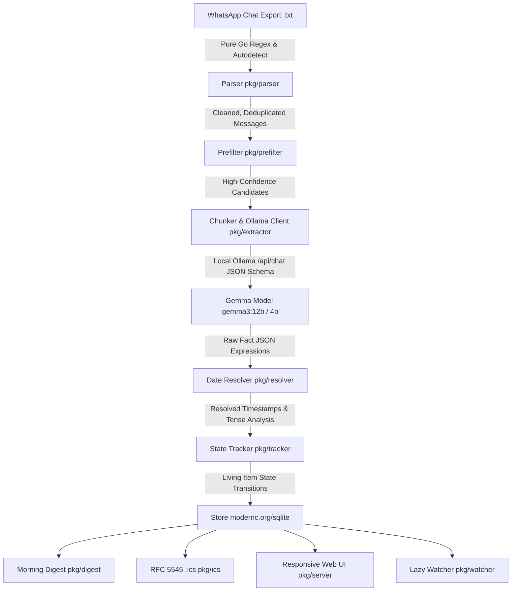

# Aalsi (आलसी) — Local-First Deadline Catcher for College Students

> *"Aalsi did the reading. You do the doing."*

[](https://golang.org)
[](LICENSE)
[](#privacy)

College WhatsApp groups bury the one vital message (*"assignment due Friday"*, *"fee last date 28th"*, *"lab shifted to 3 PM"*) under hundreds of memes, jokes, and "ok sir". 

**Aalsi** is a single-binary, privacy-first tool: you drop in an exported chat text file (`.txt`), and Aalsi extracts deadlines using open-weight **Gemma** running locally on Ollama, resolves dates deterministically in Go, tracks living deadline state across reminders and updates, and delivers:
1. 🌅 **A Morning Digest**: A two-line daily summary plus Today / Tomorrow / This Week cards.
2. 📅 **A Calendar File (`.ics`)**: Standards-compliant RFC 5545 calendar with 1-day & 1-hour alarms and original message evidence.
3. ⚠️ **A "You May Have Missed" List**: Catches overdue items before they slip away.
4. 🛌 **Lazy Mode (`aalsi watch`)**: Automatically monitors your inbox folder overnight and exports calendars with zero manual clicking.

---

## 🚀 60-Second Quickstart

### 1. Prerequisites
- **Go 1.22+** installed on your machine.
- **Ollama** installed:
  ```bash
  ollama serve
  ollama pull gemma3:12b    # Default high-accuracy model
  # Or for lightweight laptops:
  ollama pull gemma3:4b     # Fast laptop option
  ```

### 2. Exporting WhatsApp Chat
1. Open your college group chat on WhatsApp (Android or iOS).
2. Tap the three dots / Group Info &gt; **More** &gt; **Export chat**.
3. Choose **Without Media** (this generates a lightweight `.txt` export).
4. Save the `.txt` file onto your machine.

### 3. Launch Aalsi
```bash
# Clone and run
git clone https://github.com/GhanshyamJha05/Aalsi.git
cd Aalsi

# Start local server
make run
# Or directly with Go:
go run ./cmd/aalsi
```
Open **[http://127.0.0.1:8080](http://127.0.0.1:8080)** in your browser! Drop your `.txt` file into the box.

### Exposing to LAN (Local WiFi / Mobile)
Want to check deadlines on your phone while connected to your home or hostel WiFi?
```bash
go run ./cmd/aalsi --lan
```
Aalsi automatically detects your LAN IPv4 address (e.g. `http://192.168.1.15:8080`), displays it clearly in the terminal, and serves your mobile browser.

---

## 🏗️ Architecture & Philosophy



### Core Design Rule: **"THE MODEL READS, THE CODE DECIDES"**
LLMs are creative language understanders, but notoriously unreliable calendar arithmetic engines. Aalsi adheres strictly to this rule:
- **Gemma extracts raw linguistic facts**: `kind`, `title`, verbatim `raw_date_expression` (e.g., `"kal"`, `"Friday"`, `"28th Oct"`, `"next Monday tak"`), and `action_needed`.
- **Pure Go computes everything else**: Date resolution relative to message timestamps, Indian standard tense cues, assignment deduplication, status mutations (postponements, cancellations, reminders), and RFC 5545 calendar formatting are 100% deterministic, table-tested Go code.

### 📝 Digest Text Generation: Code-Generated vs Model-Generated
- **How Digest Wording is Generated**: All bucket divisions (Today, Tomorrow, This Week, You May Have Missed), counting, tense formatting, and pluralized wording (*"1 deadline"*, *"2 deadlines"*, *"1 other task"*, *"2 other tasks"*) are **100% code-generated deterministically in Go** (`pkg/digest/digest.go`).
- **Why this design**: Language models can hallucinate counts or drop urgent deadlines. By computing summary counts and text strings with deterministic code logic, Aalsi guarantees that the morning digest is accurate, consistent, and never invents or omits tasks. Gemma is reserved purely for entity and linguistic extraction from the raw WhatsApp chat text.

---

## 🔒 Privacy & Cloud-Sync Warning

> [!CAUTION]
> **Cloud Sync Privacy Hazard (OneDrive / Dropbox / iCloud / Google Drive)**:
> **Do NOT store, export, or keep WhatsApp chat `.txt` files in cloud-synced folders** (such as `OneDrive`, `Dropbox`, `iCloud Drive`, or `Google Drive`).
> 
> Saving exported chats inside synced desktop folders automatically uploads your classmates' personal phone numbers, chat logs, and faculty notices to cloud provider servers, defeating Aalsi's local-first offline privacy guarantee.
> 
> **Best Practice**: Keep your chat exports in a local directory outside sync mirrors (e.g. `C:\Users\<user>\LocalAalsiChats\` on Windows, or `~/.aalsi/chats/` on macOS/Linux), and use Aalsi's built-in **"Purge Local Data"** button to erase processed records when finished.

### Why Open Models?

1. **Absolute Privacy**: Private group chats and faculty correspondence never leave your laptop. No cloud telemetry, no remote training.
2. **Zero API Cost**: Run as many 10,000-message chat exports as you want without paying OpenAI, Anthropic, or Google Cloud per token.
3. **Works 100% Offline**: In a hostel or airplane with patchy internet? Gemma and Aalsi work entirely without network connectivity.
4. **Flexible Sizing**: Run `gemma3:12b` on capable machines for maximum precision, or drop down to `gemma3:4b` on any standard lightweight laptop.

---

## 🛌 Lazy Mode (Hands-Free Watcher)

Tired of manually uploading chats? Set up a watch folder:
```bash
aalsi watch ~/Aalsi/inbox ~/Aalsi/out
```
Whenever you drop an exported chat into `~/Aalsi/inbox`, Aalsi wakes up, idempotently processes the new messages, and writes:
- `~/Aalsi/out/morning_digest.txt` (ready to copy and send)
- `~/Aalsi/out/aalsi_deadlines.ics` (auto-syncable by your calendar app)

---

## ⚙️ CLI Reference & Makefile

| Command | Description |
| :--- | :--- |
| `make run` | Starts the local web server on port 8080 |
| `make test` | Runs all unit and integration tests |
| `make demo-data` | Generates synthetic 3-week college chat data with ground truth |
| `make eval` | Runs the full quantitative evaluation benchmark |
| `aalsi purge` | Safely wipes all local SQLite database records |

---

## ⚠️ Limitations & Honesty

- **Manual Export Required**: Because WhatsApp does not offer an official open API for personal chats, you must manually export the `.txt` from WhatsApp once every few days.
- **Hinglish Ambiguity**: Words like *"kal"* mean both *yesterday* and *tomorrow*. While Aalsi uses surrounding tense cues (`"submit karna hai"` vs `"submit kiya tha"`), ambiguous instances are safely routed to the **Review Queue** rather than guessed.
- **System Requirements for 12B**: Running `gemma3:12b` locally requires at least 8GB of free VRAM/RAM. On lower-spec laptops, configure `gemma3:4b` in the Settings dropdown.
